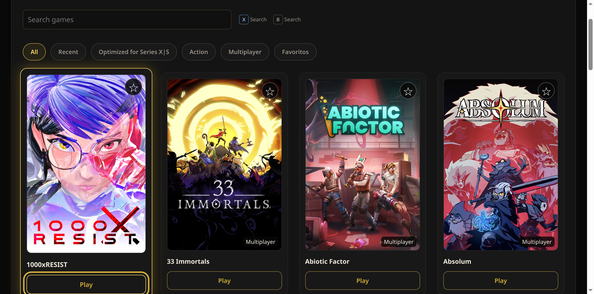
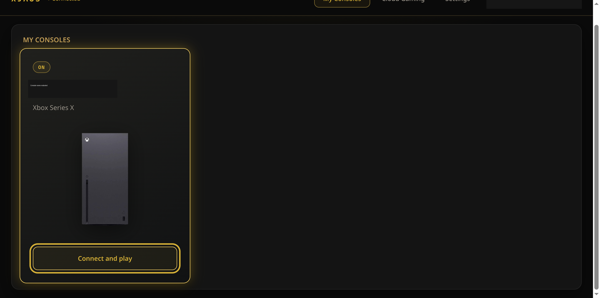
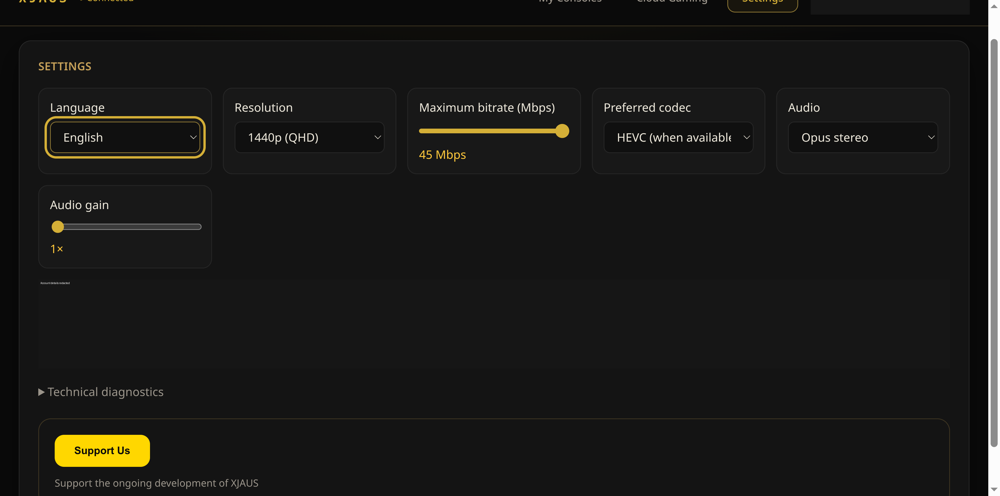
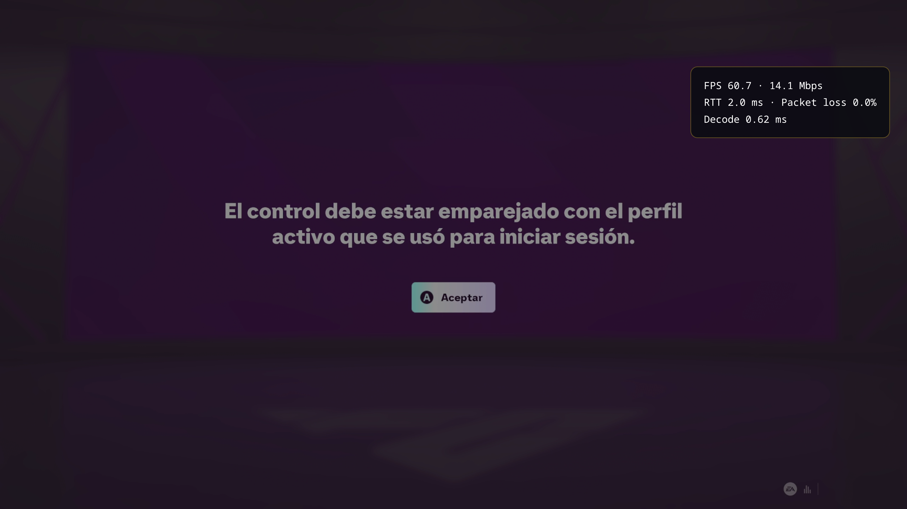

# XJAUS

XJAUS is an Electron desktop client with a Rust sidecar for Xbox Cloud Gaming and Xbox Remote Play. It is an independent, GPL-3.0-only project for Linux x86_64 and Windows x64.

Download the current release from [GitHub Releases](https://github.com/perjesus111-hub/xjaus/releases/latest).

## What it does

- Starts Cloud Gaming sessions and Remote Play sessions for a compatible Xbox console.
- Uses a controller-oriented, 10-foot interface with stream-menu navigation and visible gamepad focus.
- Offers Auto, H.264, and HEVC preferences; resolution profiles up to 1440p; and a 15–45 Mbps bitrate request.
- Keeps authentication, session control, console discovery, and streaming signaling in a Rust sidecar.

## Availability and limits

XJAUS requires an eligible Microsoft account, a supported region, and a suitable network connection. Cloud Gaming access also depends on the subscription and service requirements in effect for the account.

Resolution, codec, frame rate, bitrate, controller behavior, advanced rumble, and hardware decode depend on the negotiated stream, hardware, drivers, runtime, and network. The VA-API flags enable Chromium feature requests on Linux; they do not prove that a hardware decoder is in use. A selected 1440p profile or bitrate is likewise a request, not a delivery guarantee.

## Downloads

The [latest release](https://github.com/perjesus111-hub/xjaus/releases/latest) publishes these x86_64 packages when available:

| System | Package | Install or run |
| --- | --- | --- |
| Linux | AppImage | `chmod +x XJAUS-*.AppImage && ./XJAUS-*.AppImage` |
| Fedora/RHEL-family Linux | RPM | `sudo dnf install ./XJAUS-*.rpm` |
| Debian/Ubuntu-family Linux | DEB | `sudo apt install ./XJAUS-*.deb` |
| Windows x64 | NSIS installer | Run `XJAUS-*-win-x64-setup.exe` |

Each release includes `SHA256SUMS`; verify the downloaded artifact before installing it. The Windows installer is per-user by default, has a directory chooser, and includes the Rust sidecar. The NSIS bootstrap may be PE32, while the installed Electron application and sidecar are x64.

AppImage may need the distribution's FUSE compatibility package. If FUSE is unavailable, try `--appimage-extract-and-run`. Do not disable Electron's sandbox as an installation workaround.

## Screenshots

Captured from the packaged Electron AppImage on Linux. Saved account details are redacted; these are not mock streams.

| Cloud Gaming dashboard | Console management |
| :---: | :---: |
|  |  |
| Bitrate and video settings | Remote Play with telemetry |
|  |  |

The Remote Play capture shows received 2560×1440 video and increasing decoded frames in one local run. Its console is showing a controller/profile pairing prompt, so it is not gameplay-control verification and it does not establish hardware decoding or general performance.

## Build from source

Install Node.js/npm, Rust, and the native development packages required by Tauri/WebKitGTK on Linux. The retained Tauri project remains a build dependency of the Rust sidecar even though shipped releases use Electron for the interface.

```sh
npm ci
npm run typecheck
npm test
npm run build
cargo test --manifest-path src-tauri/Cargo.toml --bin xjaus_backend
```

For a Linux package build, run `npm run dist:linux`. Renderer output stays in `dist/`; package artifacts go to `release/linux/`. Windows cross-packaging details are in [WINDOWS-BUILD.md](WINDOWS-BUILD.md).

## Architecture

See [docs/ARCHITECTURE.md](docs/ARCHITECTURE.md) for the Electron renderer/main/preload boundary, Rust-sidecar protocol, and why `src-tauri/` is retained.

## FAQ

**Is XJAUS affiliated with Microsoft or Xbox?** No. XJAUS is an independent project and is not affiliated with, sponsored by, or endorsed by Microsoft or Xbox.

**Why did the stream not use my selected codec, resolution, or bitrate?** Those settings are preferences negotiated with the service. Inspect received video and decoder telemetry rather than inferring results from the selected profile.

**Why does an AppImage not start?** Install your distribution's FUSE compatibility package or use the documented extract-and-run fallback.

## Get help and contribute

Use the issue templates to report a reproducible problem or request a feature. For streaming problems, include the package version, distribution, Wayland/X11, GPU and driver, controller model, and whether the issue is Cloud Gaming or Remote Play. Never attach tokens, account caches, device-code responses, or unredacted authentication logs.

Read [CONTRIBUTING.md](CONTRIBUTING.md) before proposing a change. Security-sensitive reports belong in [SECURITY.md](SECURITY.md), not a public issue.

## License and acknowledgments

XJAUS is distributed under the [GNU General Public License v3.0](LICENSE). Preserve upstream copyright and license notices when redistributing or modifying the project.

Protocol and implementation research references xal-node, xbox-xcloud-player, OpenXbox, and the Greenlight contributors. Third-party dependencies retain their own licenses. Microsoft/Xbox names, game artwork, and console imagery are not relicensed under GPL by this repository; confirm redistribution rights for bundled visual assets before a public release.

Donations are voluntary and do not purchase Microsoft services, subscription access, or guaranteed support.