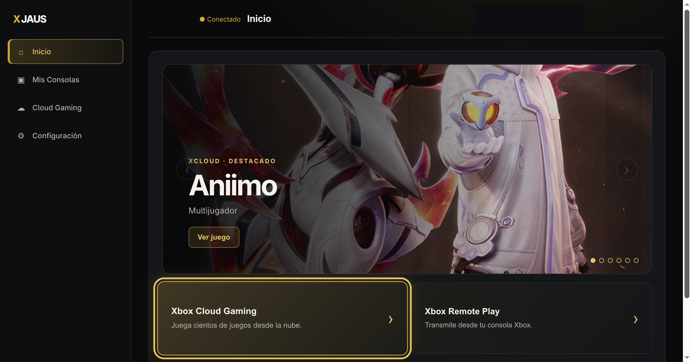
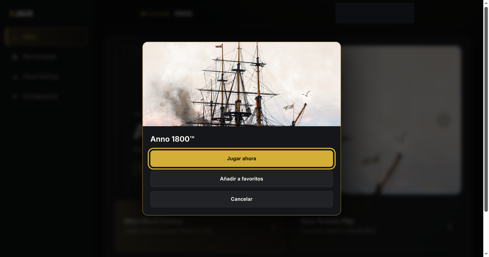
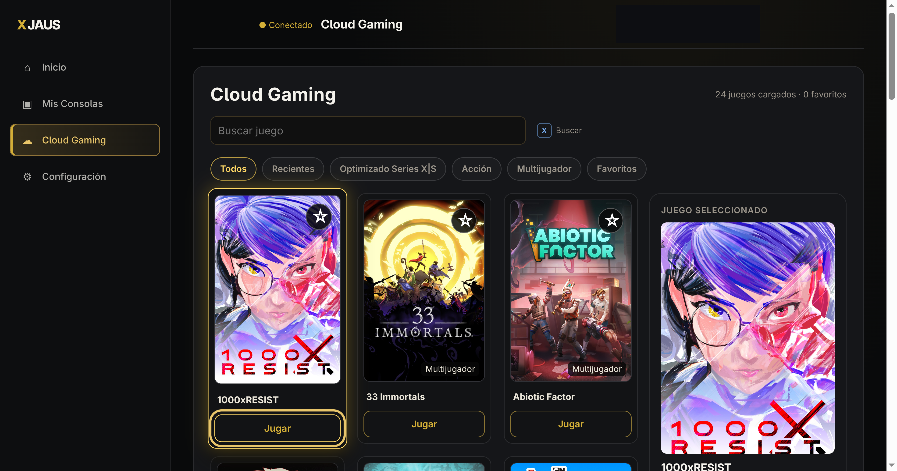
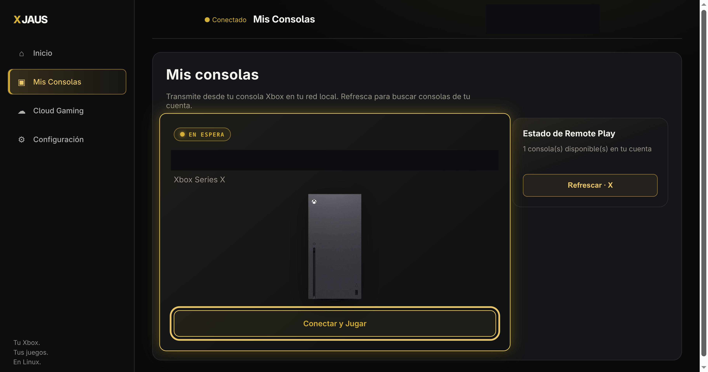
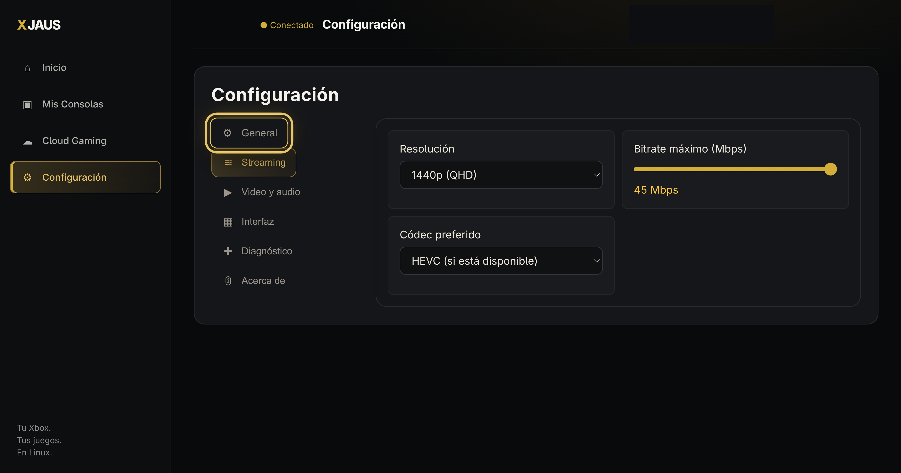
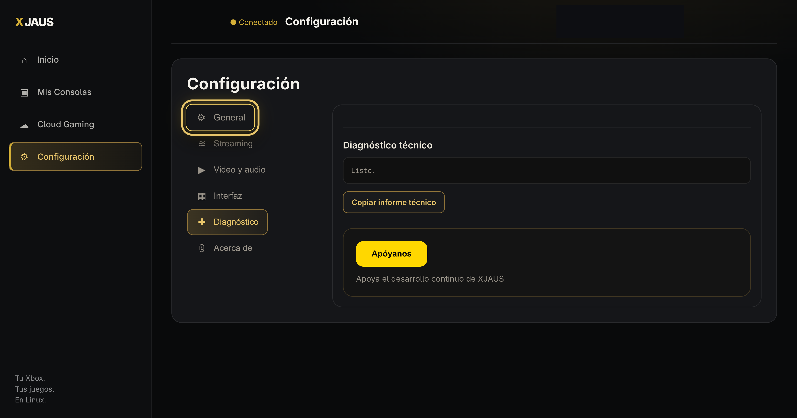

# XJAUS

**Xbox Cloud Gaming and Xbox Remote Play for the Linux gaming community.**


XJAUS pairs a controller-oriented Electron interface with a Rust sidecar for authentication, streaming control and session management. It supports cloud gaming and streaming from your own Xbox console. An eligible Microsoft account, supported region and network connection are required; cloud access depends on your subscription and the service's current requirements.

## Features and practical limits

- **Hardware video acceleration flags enabled for VA-API on Wayland/X11.** Actual hardware decoding depends on your GPU, drivers, Chromium runtime and negotiated codec. Feature flags alone do not establish hardware decoder use or battery-life improvements.
- **Configurable stream bitrate requests up to 45 Mbps via dynamic SDP negotiation.** The slider spans 15–45 Mbps. These are requests, not guaranteed delivered bitrates.
- **Selectable resolution profiles up to 1440p**, with Auto, H.264 and HEVC codec preferences. HEVC is preferred only when offered by the negotiated stream; actual resolution and frame rate depend on the service, hardware and network.
- **10-foot interface** with gamepad navigation and contextual controller shortcuts. Controller compatibility and advanced rumble features vary by device and transport.
- **Automatically hidden stream HUD and cursor**, with an optional telemetry overlay.
- **Idle-work reduction:** controller navigation avoids continuous animation-frame polling when no gamepad is connected. Console presence polling is scoped to the console view and suspended during streaming. This is not a claim of zero CPU usage.
- **Session lifecycle handling** with a short network-disruption grace period and local teardown that does not wait indefinitely for a remote shutdown request.
- **Dynamic Home with a daily featured carousel** built from the real, entitled Cloud Gaming catalog (six art-backed titles per day), automatic rotation and full mouse/keyboard/gamepad navigation. The banner dialog offers Play now (reusing the validated cloud connect flow), add/remove favorite and Cancel; it never starts a stream by itself.
- **Favorites shared across Home and Cloud Gaming** through one library, synchronized immediately in both directions.
- **Settings organized in six sections** — General, Streaming, Video & audio, Interface, Diagnostics, About — with a persisted Interface-preferences namespace kept separate from streaming settings, and a Diagnostics section whose "Copy technical report" action redacts credential-like values before the report leaves the machine.
- **In-game stream menu** reachable with the controller during playback.

## Screenshots

Captured from the packaged Electron AppImage on Linux (XJAUS 1.2.0). Account details are redacted in the saved images; no mock account or fabricated stream is shown.

| Home carousel | Featured-title dialog |
| :---: | :---: |
|  |  |
| **Cloud Gaming catalog** | **Console management** |
|  |  |
| **Settings — Streaming** | **Settings — Diagnostics** |
|  |  |

## Packages

Release packaging targets **AppImage, RPM and DEB for x86-64** on Linux, plus an **NSIS installer for Windows x64**. Download packages only from this repository's published GitHub Releases once available. Do not use older Tauri bundles as substitutes for the Electron release.

### AppImage

```sh
chmod +x XJAUS-*.AppImage
./XJAUS-*.AppImage
```

AppImage support may require your distribution's FUSE compatibility package. If FUSE is unavailable, try the runtime's `--appimage-extract-and-run` option. Do not disable Electron's sandbox as an installation workaround.

### Fedora / RPM-based distributions

```sh
sudo dnf install ./XJAUS-*.rpm
```

### Debian / Ubuntu

```sh
sudo apt install ./XJAUS-*.deb
```

### Windows (x64)

```powershell
XJAUS-*-win-x64-setup.exe
```

The Windows installer is per-user by default and lets you choose the installation directory. It bundles the same Rust sidecar as the Linux build, so no separate backend download is required. The NSIS bootstrap is 32-bit while the installed application, Electron runtime and sidecar are x64.

Launch XJAUS from your application menu after installation. Packaging support is not certification that every Linux distribution or SteamOS version has been tested.

## Build from source

Install Node.js/npm, Rust and your distribution's native development prerequisites. The retained Rust project includes Tauri dependencies, so Linux builds also need GTK/WebKitGTK development libraries even though the distributed interface uses Electron.

```sh
npm ci
npm test
npm run dist:linux
```

The renderer build is kept in `dist/`; Linux installers are written separately to `release/linux/` to avoid overwriting renderer assets. Keep `src-tauri/Cargo.lock` under version control for reproducible application builds.

## Reporting issues

Include your distribution, desktop session (Wayland or X11), GPU/driver, package version, controller model and whether the problem affects cloud gaming or Remote Play. Distinguish a selected profile from actual received video dimensions and decoder statistics. Never attach access tokens, account caches or unredacted authentication logs.

### Support Ongoing Development

XJAUS is free, open-source software built for the Linux gaming community. If you enjoy the project and want to support continued updates, bug fixes, and feature additions, contributions are welcome:

[](https://paypal.me/Comicoon)

Donations are voluntary and do not purchase Microsoft services, subscription access or guaranteed support.

## License and acknowledgments

XJAUS is distributed under the GNU General Public License version 3. See [LICENSE](LICENSE). Preserve upstream copyright and license notices when redistributing or modifying the project.

Protocol and implementation research references xal-node (including its Device Code authentication flow in msal.ts), xbox-xcloud-player and OpenXbox projects. Third-party dependencies retain their own licenses. Microsoft/Xbox names, game artwork and console imagery are not relicensed under the GPL by this repository; redistribution permissions for bundled visual assets must be reviewed before a public release.

Based on the original architecture and authentication behavior by the Greenlight contributors, licensed under GPL-3.0.

## Disclaimer

XJAUS is an independent open-source project and is not affiliated, sponsored, or endorsed by Microsoft or Xbox.
